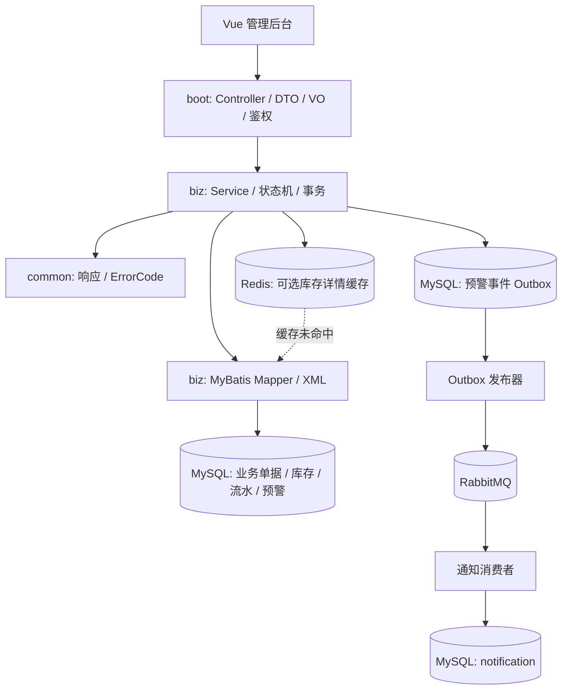
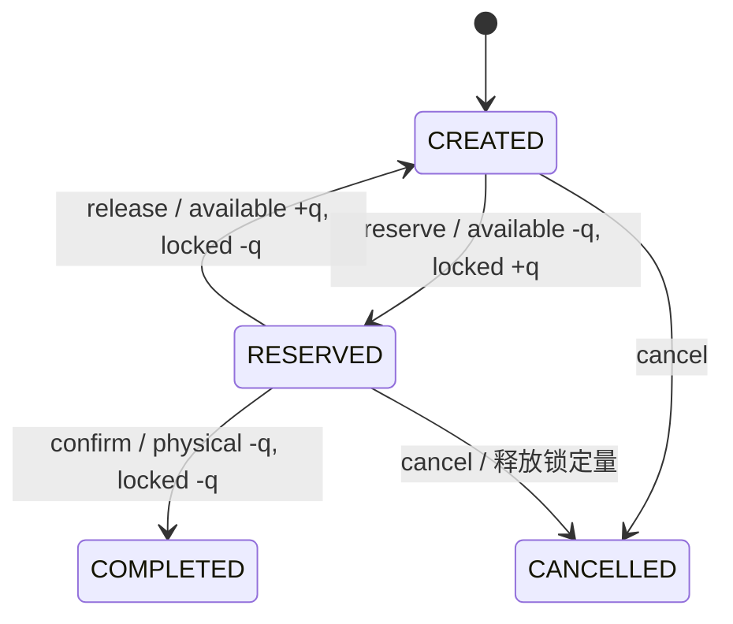
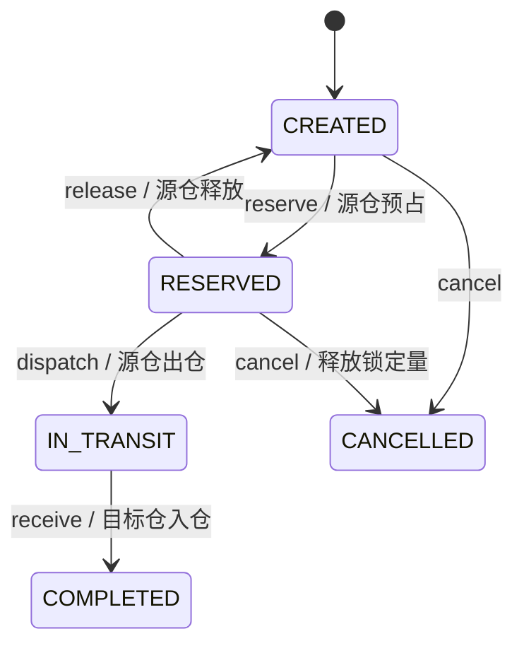

# 云仓智配：多仓库存与调拨协同平台

面向 Java 后端实习展示的单体库存管理项目。业务背景是多个仓库共享 SKU 目录，需要在入库、出库、调拨和盘点时保持库存可用量、锁定量与实物量一致，并留下可追溯的流水。V1.0 定义了 50 个 HTTP 操作，契约见 [OpenAPI](docs/yuncang-openapi.yaml)，逐项验收见 [接口矩阵](docs/V1.0-接口验收矩阵.md)。

## 技术栈与模块结构

Java 17、Spring Boot 3.5、MyBatis、PageHelper、MySQL 8、JUnit 5、H2（普通测试）、Vue 3、TypeScript、Element Plus。Redis 是可选的单条库存查询缓存，RabbitMQ 仅用于可选的 V1.1 库存预警通知。MySQL 始终是库存真实数据源。

| 模块 | 职责 |
|---|---|
| `cloud-warehouse-common` | 统一响应、错误码、业务异常、分页结构 |
| `cloud-warehouse-biz` | Entity、Mapper/XML、Service、库存事务、流水、预警 |
| `cloud-warehouse-boot` | Controller、DTO/VO、JWT、权限、全局异常、Redis 缓存、创建请求幂等、MQ 通知、Knife4j |
| `cloud-warehouse-web` | 管理后台 |

依赖方向：`boot → biz → common`。MySQL 是库存的唯一真实数据源。

## 数据库与库存模型

V1 核心表包括 `warehouse`、`sku_category`、`sku`、`warehouse_stock`、四类单据及明细、`stock_flow`、`stock_alert`、`app_user`，共 15 张。V1.1 可选迁移增加 `create_request_idempotency`、`stock_alert_outbox`、`notification` 三张表。`warehouse_stock` 对 `(warehouse_id, sku_id)` 有唯一约束；库存值满足 `physical_stock = available_stock + locked_stock`，且三项非负。不存在库存行时查询返回零库存；首次入库确认和首次调拨收货才创建库存行。`stock_flow` 追加保存三项库存的前后值和差值。`stock_alert` 每仓每 SKU 至多一条当前状态记录，`available_stock < safety_stock` 为 ACTIVE，恢复后为 RESOLVED。

## 业务流程与状态机

入库：`PENDING → confirm → COMPLETED`，实物量与可用量同加，写 `INBOUND`。盘点：`DRAFT → confirm → COMPLETED`，先核对创建时三项库存快照，计算 `countedPhysical - snapshotPhysical`；只对非零差值写 `STOCKTAKE_ADJUST`。

## 并发、事务、幂等与异常

动作型接口在 Service 上开启数据库事务，锁定单据行，检查状态，按 SKU 顺序处理明细，并通过数据库条件 UPDATE 防止扣成负数。单据、库存、流水和预警同事务提交；任一明细失败，整单回滚。重复动作返回 `ORDER_STATE_CONFLICT`，不会重复改变库存。首次库存行由唯一键与 upsert 保护。创建型接口可传 `Idempotency-Key`；同一用户、操作和键共享一条唯一记录，键与业务单据同事务提交。重试返回同一单据；相同键改请求体返回 `IDEMPOTENCY_KEY_CONFLICT`。未传请求头仍按 V1 行为创建。全局异常处理将 `BusinessException(ErrorCode)` 映射到统一的 `ApiResponse`，数据库锁竞争返回可重试的业务错误。

## Redis 与 RabbitMQ

设置 `STOCK_CACHE_ENABLED=true` 后，仅单仓单 SKU 详情使用 Cache Aside。缓存键带库存代数版本，基础 TTL 默认为 5 分钟、随机抖动 30 秒；提交成功后提升代数并删除旧值，避免事务提交前写入缓存，也避免旧读并发回填当前版本。Redis 故障时回源 MySQL；缓存失效失败后，读取可能在 TTL 内短暂滞后，强一致的扣减仍只读写 MySQL。不存在的库存行不缓存；后续若需要针对高频空查询防穿透，可结合 SKU 启用状态设计短 TTL。

`NOTIFICATIONS_ENABLED=true` 时，库存事务同步更新预警状态；只有 ACTIVE/RESOLVED 状态变化才在同一事务写 `stock_alert_outbox`。后台发布器使用 RabbitMQ Publisher Confirm 和 mandatory Return，成功后标记 SENT，失败保留 PENDING 并重试。消费者把事件写入 `notification`，数据库 `event_id` 唯一约束处理重复投递；异常消息拒绝重排并进入专用死信队列。管理员和仓库经理可通过 `GET /api/v1.1/notifications` 查看共享通知列表。通知是最终一致的，库存扣减不依赖 RabbitMQ。消费者故障消息进入死信队列后需人工检查、修复并重投；当前未实现自动死信重放。

## 运行与配置

环境要求：JDK 17、Maven、MySQL 8.0.16+；前端需 Node.js。数据库脚本依次执行 [01-schema.sql](docs/sql/01-schema.sql)、[03-v1-business-schema.sql](docs/sql/03-v1-business-schema.sql)，需要演示数据再执行 [02-demo-data.sql](docs/sql/02-demo-data.sql)。使用可选请求头前执行 [04-v1_1-idempotency.sql](docs/sql/04-v1_1-idempotency.sql)；启用通知前执行 [05-v1_1-notifications.sql](docs/sql/05-v1_1-notifications.sql)。脚本不会由 IDE 启动时自动执行。

### IDE 或本机 MySQL

1. 在 MySQL 建库：`CREATE DATABASE yuncang CHARACTER SET utf8mb4;`，按上述顺序执行 SQL。
2. 设置 `DB_URL`（默认本机 3306）、`DB_USERNAME`（默认 root）、`DB_PASSWORD`、`JWT_SECRET`（至少 32 字节随机值）。可用 PowerShell 生成：`[Convert]::ToBase64String([Security.Cryptography.RandomNumberGenerator]::GetBytes(48))`。
3. 在 IDEA 运行 `CloudWarehouseApplication`，或执行 `mvn clean verify` 后运行 `java -jar cloud-warehouse-boot/target/cloud-warehouse-boot-1.0-SNAPSHOT.jar`。默认端口 8080，默认 MySQL profile。测试使用 H2，不会修改本机 MySQL。

本地演示数据包含 `admin / 123456`，仅供学习环境；实际部署需换密码和 JWT 密钥。环境变量示例见 [.env.example](.env.example)。

### Redis 与 RabbitMQ 可选配置

单条库存缓存设置 `STOCK_CACHE_ENABLED=true`、`REDIS_HOST`、`REDIS_PORT`，有密码时设置 `REDIS_PASSWORD`。通知先应用 05 脚本，再设置 `NOTIFICATIONS_ENABLED=true`、`RABBITMQ_HOST`、`RABBITMQ_PORT`、`RABBITMQ_USERNAME`、`RABBITMQ_PASSWORD`。生产启动前先确认 MQ 账号有声明交换机/队列的权限。通知默认关闭，未启用时 V1 库存和预警不依赖 RabbitMQ。V1.1 的启用顺序和语义见 [扩展文档](docs/V1.1-扩展接口与部署.md)。

### Docker 启动依赖服务

复制 `.env.example` 为 `.env`，设置 `MYSQL_ROOT_PASSWORD`、`REDIS_PASSWORD`，执行 `docker compose up -d`。Compose 仅启动 MySQL 与 Redis，应用仍由 IDE 或 jar 启动。首次创建数据卷时会按编号初始化 V1 15 张表和演示数据；V1.1 迁移需按上文手动执行。已有数据卷不会自动重放 SQL。将 `DB_PASSWORD` 设为 `.env` 中的 MySQL 密码；若开启缓存，再设置 `STOCK_CACHE_ENABLED=true`、`REDIS_PASSWORD`。Redis 地址与端口可用 `REDIS_HOST`、`REDIS_PORT` 指定。`.env` 已忽略，不提交密钥。

### 前端

进入 `cloud-warehouse-web` 执行 `npm install`、`npm run dev`，打开 `http://127.0.0.1:5173`；Vite 默认代理到本机 8080，可设置 `VITE_PROXY_TARGET`。`npm run build` 检查类型并构建页面。

## 测试与 API 文档

`mvn clean verify` 运行普通集成测试和缓存单测。`PhaseOneIntegrationTest` 核对 50 条 V1 契约路由、认证与权限；`V1WorkflowIntegrationTest` 检查完整库存生命周期。真实 MySQL、Redis、RabbitMQ 测试通过隔离数据库脚本按需运行，完整命令和结果见 [简历版验收报告](docs/云仓智配简历版最终验收报告.md)。

Knife4j：`http://localhost:8080/doc.html`。契约 JSON：`/openapi/yuncang-openapi.json`；Controller 生成的调试 JSON：`/v3/api-docs`。先调用 `POST /api/v1/auth/login` 获取 token，再通过 `Authorization: Bearer <token>` 调试。完整调用说明见 [V1.0 最终接口文档](docs/V1.0-最终接口文档.md)。

## 项目难点与学习材料

最值得解释的是：库存三量不变量、条件更新与单据行锁、整单事务回滚、调拨在途量、盘点快照冲突、Redis 提交后失效。没有未经验证的吞吐量或性能提升数据。面试材料见 [简历项目描述](docs/Java后端实习简历项目描述.md)、[项目面试题](docs/项目面试题.md)。
