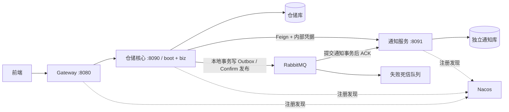

# 云仓智配微服务运行与切换手册

> 最新进度（2026-10-21）：经用户确认，已使用 compose.lab.yaml 新建独立 Docker 联调环境，8 个容器均健康，14 项真实业务检查通过；另验证了真实 MQ 重复投递去重和无效消息入死信。原开发库未接入。详见 [Docker 联调验收记录](docker-lab-acceptance.md)。下文的首次构建失败记录保留为历史；停机恢复演练、旧环境迁移与切换仍未执行。

## 交付边界

采用三个独立 Java 进程：网关、仓储核心服务、通知服务。代码可独立打包部署。
实际数据库初始化、历史数据迁移、Nacos/RabbitMQ/Redis/MySQL 联调和运行流量切换需要在指定环境执行，本次没有操作现有业务库。

不是把每个 Maven 模块当成一个服务。common 是共享协议库；boot + biz 组成一个仓储核心服务。
库存预占、出库确认、调拨、盘点、库存流水、库存预警和 Outbox 继续处于同一个本地事务边界。
账号权限、仓库、SKU、分类仍属于仓储核心，避免在库存事务中引入跨服务外键与远程读取。
当前不存在独立认证/商品/库存等额外服务，也没有引入分布式事务协调器。

## 运行架构



外部通知路径保持 /api/v1.1/notifications?page=1&size=20，返回 ApiResponse<PageResult<NotificationView>>。
网关只转发公开 API，移除传入的 X-Internal-Token；不路由 /internal/**。
仓储服务仍执行 JWT、账号有效性和 ADMIN/WAREHOUSE_MANAGER 角色校验，再调用通知内部接口。
通知内部路径 /internal/v1/notifications/page 验证内部凭据，返回 PageResult。
演示内部接口 /internal/v1/notifications 和学习接口保留。
通知服务、仓储服务端口只放在可信内部网络；网关不是唯一的鉴权点。

## 启动配置

| 进程 | 模块 | profile | 端口 |
| --- | --- | --- | --- |
| 仓储核心 | cloud-warehouse-boot | mysql,microservices | 8090 |
| 通知 | cloud-warehouse-notification-service | notification-mysql | 8091 |
| 网关 | cloud-warehouse-gateway | 无要求 | 8080 |

仓储核心在 microservices profile 中启用 Outbox，排除旧本地通知查询和旧消费者，启用远程通知 Controller。
未启用 microservices 时保留原单体模式，仅用于切换前验证/受控回退。不能同时将新旧消费者接到同一队列，否则消息会被分流到两个库。
通知消费还需 NOTIFICATION_CONSUMER_ENABLED=true；为 false 时可以先验证查询和历史数据，避免提前消费。
通知数据库模式必须提供非空 APP_INTERNAL_TOKEN。两端使用同一个运行时注入的随机凭据。
数据库环境变量不能回退到仓储库；NOTIFICATION_DB_URL 必须由操作者核对，数据库账号权限须限制在通知 schema。

共享变量：NACOS_SERVER_ADDR、APP_INTERNAL_TOKEN。
仓储变量：DB_URL、DB_USERNAME、DB_PASSWORD、JWT_SECRET、REDIS_HOST/PORT/PASSWORD、RABBITMQ_HOST/PORT/USERNAME/PASSWORD。
通知变量：NOTIFICATION_DB_URL、NOTIFICATION_DB_USERNAME、NOTIFICATION_DB_PASSWORD、RABBITMQ_HOST/PORT/USERNAME/PASSWORD、NOTIFICATION_CONSUMER_ENABLED。
RabbitMQ 双方必须连接同一个 vhost（默认 /），自定义时两端均设置 SPRING_RABBITMQ_VIRTUAL_HOST。
自定义 exchange/queue 时双方设置相同 NOTIFICATIONS_EXCHANGE、NOTIFICATIONS_QUEUE。
生产凭据、Nacos namespace/group/auth 按部署环境额外注入 Spring 配置，不提交到 Git。
部署中仅暴露 health/info，不开放环境变量等管理端点；健康信息不显示详情。

## 打包与启动

在仓库根目录执行：
```powershell
mvn -B -ntp -DskipTests package
```
不使用 clean。分别在三个已配置环境变量的终端运行：
```powershell
java -jar cloud-warehouse-boot/target/cloud-warehouse-boot-1.0-SNAPSHOT.jar --spring.profiles.active=mysql,microservices
java -jar cloud-warehouse-notification-service/target/cloud-warehouse-notification-service-1.0-SNAPSHOT.jar --spring.profiles.active=notification-mysql
java -jar cloud-warehouse-gateway/target/cloud-warehouse-gateway-1.0-SNAPSHOT.jar
```

可选容器部署：
1. 参考 deploy/microservices/environment.example 在仓库外创建本地环境文件。
2. 准备独立验证环境的基础设施、库表及账号。Compose 只启动应用，不执行建库或历史迁移。
3. 设置所有必需变量，确认数据库 URL；容器中的 localhost 不是宿主机，按网络使用可达地址。
4. 使用 docker compose --env-file <本地环境文件> -f compose.microservices.yaml up --build -d。
5. 确认三个注册实例的 IP 对网关和核心容器都可达；跨主机部署需正确设置 Nacos 注册 IP/端口。
Compose 不发布核心/通知端口，只发布本机 8080；现有前端开发代理默认已指向 8080，不需要改动。
不要对旧开发环境执行 down -v、清库或重复初始化。容器构建与运行尚需实际环境验证。

2026-10-21 Docker 安装后复查：Docker 引擎和 Compose 均可访问，Compose 配置静态校验通过。
尝试构建三个应用镜像时，拉取 eclipse-temurin:17-jre 的 Docker Hub 认证请求超时；
宿主机访问 auth.docker.io 同样超时，域名解析结果异常，需先排查 DNS/代理网络。
本次仅为配置检查与镜像构建注入占位环境变量，没有启动 Compose 服务，没有连接数据库。
新安装 Docker 后若当前终端尚未刷新 PATH，需重新打开终端，或仅在当前进程补充 Docker 安装目录。

## 数据库与消息

新通知库初始化：docs/sql/06-notification-service-dev-schema.sql，人工执行。
全新隔离仓储库依次使用 01-schema.sql、03-v1-business-schema.sql、04-v1_1-idempotency.sql、
07-warehouse-outbox-only.sql；脚本内容与目标库必须先审核，演示数据仅在隔离环境按需导入。
已有仓储库不要重新初始化。保留原 notification 表作历史核对，但微服务模式不读取/写入它。

通知表保留十个字段、event_id 唯一约束、created_at/id 与 warehouse_id/created_at 索引。
分页按 created_at DESC,id DESC；偏移使用 long 避免整数溢出。
保留默认状态 UNREAD、原通知文案、时间精度；迁移前比较 collation 和时间约定，不能仅假设默认一致。
仓储库 Outbox 写入仍参与库存事务；发布器的 Confirm/Return 检查、失败重试和锁定逻辑未改。
通知消费者使用本地事务，event_id 唯一约束防重复；数据库异常传播，消费事务提交成功后才正常返回。
监听器 AUTO ACK，失败最多尝试三次，最终拒绝且不重新入队，交给原 DLX/DLQ；无静默丢弃逻辑。
队列名称、durable、DLX 参数与旧消费者一致，不能随意修改已有队列参数。
死信监控与人工重放需要实际部署运维；不能将 H2 测试当成 RabbitMQ 投递确认或 MySQL InnoDB 验证。

## 有历史数据时的切换顺序

1. 先在独立验证环境完成后面的验收，再安排旧环境维护窗口和可恢复备份。
2. 暂停入口写请求并停止旧仓储进程，确认旧消费者与在途事务均停止。RabbitMQ 保留持久化积压。
3. 新通知库建表并保持新消费者关闭。导出旧 notification 全部十列；保留 id、event_id、status、created_at。
4. 同实例可人工审阅执行 08-notification-snapshot-copy-manual.sql；跨实例用受控导出/导入。
   脚本要求目标表为空，发生冲突必须停止处理，不能用 IGNORE 或覆盖隐藏差异。
5. 对比总数、event_id 集合、主键最大值与逐字段内容；确认新自增值超过历史最大 ID。
6. 启动通知查询（消费者仍关闭），核对空页、分页边界、同时间排序与历史内容。
7. 以 mysql,microservices 启动全部仓储实例，确保没有旧消费者实例。
8. 启用新通知消费者，然后启动网关，确认注册发现、权限与真实分页，再恢复入口写流量。
9. 触发新预警，确认库存/Outbox 提交、MQ 投递、通知入库和远程页面可见。故障恢复后重复投递不重复入库。

不能只移除 microservices profile 就回滚：新通知可能已只存在新库。
回滚前停止入口及新消费者，核对并同步新库增量回旧库（event_id 去重、解决 ID 冲突、保留时间），
验证一致后再启动旧消费者；需要单独审批和执行的数据回退脚本，本次没有对旧库执行任何回写。
回滚窗口内保留旧表和备份，不清理队列或旧数据。

## 隔离自动化验证

本轮结果：23 项不同测试通过，0 失败；全模块 package 成功。
三个可执行 JAR 的启动类均已核对，通知服务和网关均未打包 cloud-warehouse-biz。
运行时未连接已有业务数据库；数据库测试均使用内存 H2，Redis 测试使用模拟对象。
Docker 安装后已通过引擎/Compose 检查和部署配置静态校验；镜像构建因 Docker Hub 认证连接超时失败，尚未启动容器。
实际 MySQL、RabbitMQ、Nacos 联调与历史迁移尚未验证。

白名单运行测试，避免未审阅的外部 MySQL/RabbitMQ 验收测试因本机环境变量自动启用。

新增测试：NotificationPersistenceTest（内存 H2 + MyBatis + 事务 + 内部接口）、
NotificationMicroserviceBoundaryTest（H2 + 模拟 Feign + 原权限链）、
RemoteNotificationQueryServiceTest（远程调用失败语义）、GatewayRoutesTest（路由配置与内部凭据移除）、
NotificationDatabaseModeTest（无数据库模式启动）。
NotificationProfileIsolationTest 验证即使启用仓储 Outbox，microservices 模式也不会加载旧通知查询和旧消费者。
库存回归：PhaseOneIntegrationTest、SimpleBusinessIntegrationTest、V1WorkflowIntegrationTest、
InventoryAcceptanceTest（均显式 H2）、RedisStockDetailCacheTest（模拟 Redis）。

这些测试不证明跨进程注册发现、真实 MySQL 并发、RabbitMQ 重投/DLQ 或容器网络可用。
正式验收仍需独立 MySQL、RabbitMQ、Redis、Nacos 环境与受控测试数据：

- 网关登录与原库存业务闭环，仓储事务失败后库存/流水/Outbox 一起回滚。
- 通知无登录 401、操作员 403、管理员/仓库管理员成功、内部无凭据 401。
- 关闭通知服务时原接口返回通知不可用；不能返回空页成功、不能回退读旧库。
- 通知恢复后熔断半开恢复；超过限流/并发阈值时响应可预期。
- 重复/并发投递相同 event_id 只有一条通知；通知 DB 不可用时无错误 ACK，恢复后可处理死信。
- 停止发布器期间 Outbox 留在 PENDING，恢复后发送；检查 Confirm/Return 与 SENT 状态。
- 原库存并发、创建幂等及 InnoDB 验收在独立测试 schema 执行；勿直接运行指向开发库的测试。
